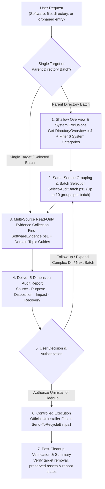

<div align="center">

# Windows Cleanup Skill

**An Evidence-Driven AI Agent Skill for Windows Software Auditing, Safe Uninstallation & Residue Cleanup**

[](https://github.com/dragonknightk/windows-cleanup/releases)
[](#requirements)
[](#requirements)
[](LICENSE)
[](SKILL.md)

**[简体中文](README.md)** | **English**

</div>

---

## Overview

`windows-cleanup` is a specialized **Windows software auditing, uninstallation, and residue cleanup skill** built for AI Coding Agents that support the `SKILL.md` specification (such as Codex CLI, Claude Code, Antigravity, Cursor, and Windsurf).

Unlike traditional "one-click PC cleaners" that blindly delete files based on folder names or extensions, this repository **contains no black-box auto-deleter**. Instead, it equips your AI Agent with a rigorous investigative methodology and bounded read-only PowerShell helpers. The Agent gathers cross-system evidence (uninstall registry keys, running processes, services, scheduled tasks, startup entries, environment variables, and Authenticode signatures), delivers a standardized **5-dimension audit report** for every item, and executes **official uninstallers, safe Recycle Bin transfers, and post-cleanup verification** strictly within your authorized scope.

---

## Why `windows-cleanup`?

Cleaning up Windows directories (`AppData`, `ProgramData`, user profiles) or leftover software residues usually forces an uncomfortable trade-off between safety and thoroughness:

| Dimension | Traditional "One-Click Cleaners" | Generic AI Prompts | **`windows-cleanup` Skill** |
|---|---|---|---|
| **Basis of Judgment** | Rigid filename/extension rules | Guesses by folder name (sees `Cache` or `Temp` and says "delete") | **Cross-system evidence (Registry, Processes, Services, Task XMLs, Signatures)** |
| **User Asset Safety** | High risk of wiping game saves, VM disks, or dev configs | Misses reference chains; easily breaks shared runtimes or sibling apps | **Protects user assets & shared SDKs; auto-excludes 6 core system categories** |
| **Analysis Depth** | Black-box checkboxes with zero context on impact | Compresses output into 1-line blurbs when given >10 folders | **Fixed 5-dimension deep audit cards + strict 10-group batch stop** |
| **Deletion Safety** | Permanent deletion with no easy rollback | Suggests destructive `Remove-Item -Recurse -Force` commands | **Official uninstaller first + verified Win32 `IFileOperation` Recycle Bin transfer** |
| **Security & Privacy** | Opaque background scanning | Leaks CLI tokens or passwords into the chat context | **12 path boundary checks (no symlink traversal) + automatic `[REDACTED]` masking** |

---

## Key Features

- **Evidence-Driven Investigation**: Never assumes a folder is safe to delete just because it is named `Cache`, `Temp`, or shares a vendor name. Cross-references 32/64-bit registry views, active processes, services, drivers, scheduled task XMLs, environment variables, and binary metadata.
- **Standardized 5-Dimension Deliverable**: Every audited target—whether a single file or a grouped directory batch—is presented with five fixed dimensions: **Source**, **Purpose**, **Can It Be Uninstalled or Deleted**, **Handling Impact**, and **Recovery & Reconstruction**, explicitly stating any evidence gaps.
- **Bounded Batching & System Exclusions**: Parent-directory audits automatically identify and exclude **6 categories of core Windows system items** (such as `NTUSER.DAT`, compatibility junctions, and `pagefile.sys`), and cap deep analysis at **10 same-source groups per batch** with on-demand drill-down for complex subdirectories.
- **Defense-in-Depth Cleanup Guardrails**:
  - **Official Uninstaller First**: Prioritizes registered uninstallers or package managers before sweeping for leftover files and registry entries.
  - **Verified Recycle Bin Interop**: Normal files and folders are moved to the Windows Recycle Bin via C# COM interop (`IFileOperation`). A custom `IFileOperationProgressSink` verifies recycle flags (`TSF_DELETE_RECYCLE_IF_POSSIBLE`) and the resulting recycled item path, aborting immediately if Windows attempts a silent permanent deletion.
- **Stateful Sessions & Automatic Redaction**: Progress, stable group IDs (`G001`), and user decisions are persisted in your workspace (`work/windows-cleanup/<task-name>/session.json` & `report.md`), while sensitive tokens, passwords, and `Bearer`/`Basic` credentials in command lines or task XMLs are automatically masked as `[REDACTED]`.

---

## Workflow



---

## Audit Report Preview

Once loaded, the Agent delivers structured, human-readable audit cards like the example below:

> In this overview, the parent directory contains 42 direct child items, with 6 core system items excluded by default (including user profile hive files and system compatibility links). The remaining 36 items are grouped by source into 14 pending sets; this batch audits 10 sets.
>
> G003 · `thumbnail-cache` — Gallery thumbnail cache, conditionally safe to clean
>
> - **Source:** Confirmed via the gallery application's local configuration file, which still points to this directory as its active cache location.
> - **Purpose:** Stores small preview thumbnails so photo lists render quickly when browsing the gallery. Your original full-resolution photos are stored in a separate verified directory.
> - **Can It Be Uninstalled or Deleted:** **Can be cleaned if you accept the one-time cost of regenerating previews.** Scope is strictly limited to this cache directory; the application itself, original photos, and user settings are preserved.
> - **Handling Impact:** The next time you open the gallery, it will rescan photos and rebuild thumbnails, causing slower initial loading. Original photos and application features remain intact.
> - **Recovery & Reconstruction:** Previews will be regenerated automatically as long as the original photos remain readable. If you need the exact pre-cleanup cache files back, restore them from the Windows Recycle Bin before emptying it.
>
> This batch audited 10 sets, with 4 pending sets remaining. You can ask to "inspect G005's source in detail", "clean G003", or say "next batch".

---

## Requirements

- **OS**: Windows 10 / Windows 11
- **Runtime**: [PowerShell 7.2 or later](https://learn.microsoft.com/en-us/powershell/scripting/install/installing-powershell-on-windows) (uses .NET 6+ filesystem and link target APIs)
- **Dependencies**: None (`RecycleInterop.cs` is compiled on-demand by PowerShell)
- **Host**: Any AI Agent supporting the `SKILL.md` specification

---

## Installation & Usage

### 1. Install into Your Agent's Skills Directory

Clone this repository into your AI Agent's skills directory, keeping the folder name `windows-cleanup`:

```powershell
# Codex CLI
git clone https://github.com/dragonknightk/windows-cleanup.git "$env:USERPROFILE\.codex\skills/windows-cleanup"

# Claude Code
git clone https://github.com/dragonknightk/windows-cleanup.git "$env:USERPROFILE\.claude\skills/windows-cleanup"

# Antigravity
git clone https://github.com/dragonknightk/windows-cleanup.git "$env:USERPROFILE\.gemini\antigravity\skills/windows-cleanup"

# Workspace-level skill directory (Cursor / Windsurf / OpenCode, etc.)
git clone https://github.com/dragonknightk/windows-cleanup.git ".agents/skills/windows-cleanup"
```

### 2. Example Prompts

Ask your Agent in natural language:

- **Inspect unfamiliar folders**: *"Check what's inside `D:\Tools` and tell me what can be safely deleted."*
- **Batch-audit a user directory**: *"Audit the non-system folders under my user profile directory, starting with the first batch."*
- **Cleanly uninstall software & leftovers**: *"Help me uninstall this old application and clean up its leftover services, scheduled tasks, and AppData folders."*
- **Fix broken system entries**: *"Check my `PATH` environment variable and startup items for broken paths from uninstalled tools."*

---

## Multi-Layer Safety Architecture

Because system cleanup carries inherent risk, `windows-cleanup` enforces six layers of defense:

| Safety Layer | Protection Mechanism |
|---|---|
| **1. Read-Only Default** | Audit requests strictly perform read-only inspection. Discovered binaries, scripts, and installers are never executed as probing commands. Cleanup only happens after explicit user selection. |
| **2. Verified Recycle Bin Sink** | [`Send-ToRecycleBin.ps1`](scripts/Send-ToRecycleBin.ps1) runs in `Preflight` mode by default and requires `-Apply` to execute. Its COM progress sink (`RecycleSink`) aborts (`E_ABORT`) if `TSF_DELETE_RECYCLE_IF_POSSIBLE` is absent or no recycled item path is produced, while keeping `FOF_WANTNUKEWARNING` active. |
| **3. 12 Path Boundary Checks** | Verifies direct fixed local volumes (`\Device\HarddiskVolume*`) via `QueryDosDevice`. Rejects volume roots, UNC shares, mapped drives, SUBST drives, device paths, Alternate Data Streams (ADS), 8.3 short names (`~`), trailing dots/spaces, reparse points (junctions/symlinks), and root system/user containers (`Windows`, `Users`, `Program Files`). |
| **4. Protected Path Overlap** | Accepts `-ProtectedPath` for user assets and shared dependencies. If any target overlaps (as ancestor, descendant, or reparse alias) with a protected path, the entire batch fails preflight before touching disk. |
| **5. Core System Exclusions** | Automatically filters 6 categories of foundational Windows files during batch overviews (`NTUSER.DAT`, compatibility links, `desktop.ini`, `pagefile.sys`, boot/recovery files, and `System Volume Information`). |
| **6. Automatic Secret Redaction** | [`Find-SoftwareEvidence.ps1`](scripts/Find-SoftwareEvidence.ps1) redacts `Authorization: Bearer/Basic` headers, passwords, tokens, API keys, and embedded URL credentials as `[REDACTED]` across process command lines, services, environment variables, and task XMLs. |

> [!IMPORTANT]
> - **Disk Space Note**: Items moved to the Recycle Bin continue to occupy disk space until the Recycle Bin is emptied.
> - **Non-File Operations**: Registry modifications export a targeted backup of the exact subkey to the task directory prior to changes. Uninstaller actions, service removals, and environment variable edits have their own recovery conditions outside the Recycle Bin.

---

## Repository Structure & Scripts

```text
windows-cleanup/
├── SKILL.md                        # Skill entrypoint: intent routing, core rules & deliverable format
├── agents/
│   └── openai.yaml                 # Display name, short description & default prompt metadata
├── references/                     # Core workflow & policy guides
│   ├── audit.md                    # Single-target auditing, evidence chains & confidence levels
│   ├── batch.md                    # Parent-directory batching, 3 count metrics & session state machine
│   ├── cleanup.md                  # 6-step uninstallation, per-type boundaries & verification criteria
│   ├── interaction.md              # 5-dimension Markdown card format & response templates
│   ├── system-exclusions.md        # 6 default system exclusion categories & disk-space entrypoints
│   ├── tools.md                    # Helper script contracts & session.json (Schema v2) specification
│   └── topics/                     # Domain-specific investigation guides
│       ├── associations.md         # Shortcuts, URL schemes, file associations, context menus, COM & adapters
│       ├── environment.md          # Machine/User/Process env vars, PATH resolution & command shims
│       ├── filesystem.md           # Program folders, caches, shared runtimes & user asset boundaries
│       ├── startup-runtime.md      # Startup entries, services, drivers, task XMLs & process attribution
│       └── web-apps.md             # PWAs, AppX packages, browser JSON configs & WebView2 hosts
└── scripts/                        # PowerShell 7.2+ helpers & self-test suites
    ├── Get-DirectoryOverview.ps1   # Bounded read-only shallow directory overview (JSON)
    ├── Find-SoftwareEvidence.ps1   # Read-only keyword evidence collector across 7 system domains
    ├── Select-AuditBatch.ps1       # Validates session.json and selects up to 10 pending groups
    ├── Send-ToRecycleBin.ps1       # Path boundary preflight & verified Recycle Bin execution
    ├── RecycleInterop.cs           # Windows Shell IFileOperation COM interop & progress sink
    ├── Test-Collectors.ps1         # Unit & read-only smoke tests for overview and evidence collectors
    ├── Test-Batch.ps1              # Batch selection & Schema v2 validation tests (62 assertions)
    └── Test-Recycle.ps1            # Recycle boundary & optional real Recycle Bin round-trip tests
```

### Running the Self-Test Suite

You can verify all helper scripts in an isolated temporary directory outside the skill root:

```powershell
$testRoot = Join-Path $env:TEMP "windows-cleanup-test-$([guid]::NewGuid().ToString('N'))"
New-Item -ItemType Directory -Path $testRoot | Out-Null
try {
    ./scripts/Test-Collectors.ps1 -TestRoot $testRoot
    ./scripts/Test-Batch.ps1 -TestRoot $testRoot
    ./scripts/Test-Recycle.ps1 -TestRoot $testRoot -ApplyRoundTrip
} finally {
    Remove-Item -LiteralPath $testRoot -Recurse -Force -ErrorAction SilentlyContinue
}
```

---

## License

Released under the [MIT License](LICENSE).
